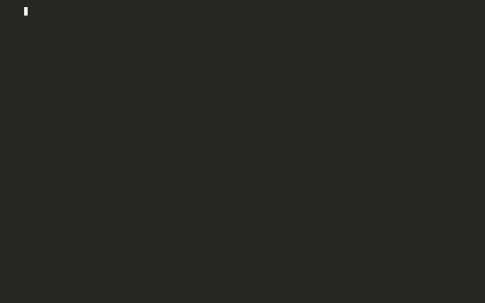
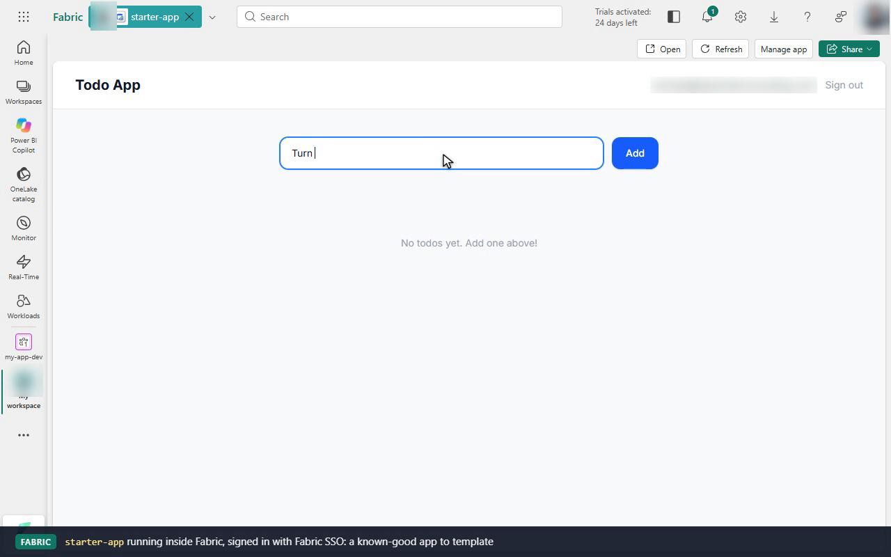
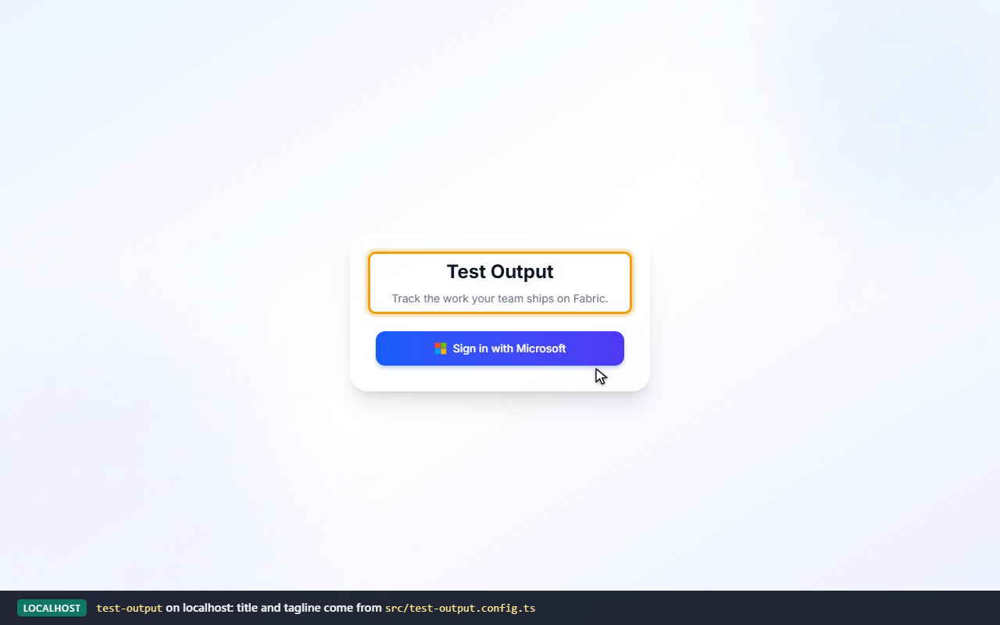
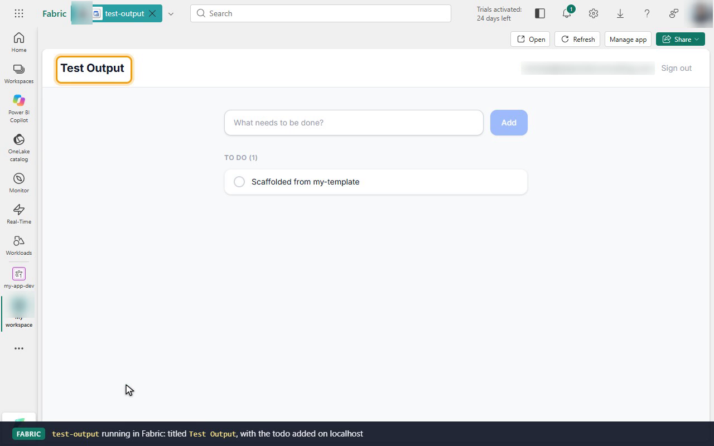

# Demo: Author a Fabric Apps template

Follows [Author and share Fabric Apps templates → Create a template](https://learn.microsoft.com/en-us/fabric/apps/author-templates#create-a-template):
build a working Fabric app, turn it into a reusable template, and scaffold a
new project from it with the Rayfin CLI. The recording also shows both apps in
Fabric: the starting app deployed and running in the portal, and the project
scaffolded from the template, first locally and then deployed as-is.



| File | What it is |
|------|------------|
| [`my-template/`](my-template/) | The finished template: `rayfin-template.yml` + app files with placeholders |
| [`recording/demo.mp4`](recording/demo.mp4) | Full demo (3m03s): the terminal run cut together with three browser segments in Fabric |
| [`recording/demo.gif`](recording/demo.gif) | Same, as a smaller GIF |
| [`recording/demo.cast`](recording/demo.cast) | Terminal portion only, as an asciicast (`asciinema play recording/demo.cast`) |
| [`recording/fabric-starter-app.png`](recording/fabric-starter-app.png) | Step 1: `starter-app` running inside the Fabric portal |
| [`recording/local-app.png`](recording/local-app.png) | Step 4: the scaffolded `test-output` app on localhost, titled from its renamed config file |
| [`recording/fabric-test-output.png`](recording/fabric-test-output.png) | Step 5: `test-output` deployed and running inside Fabric |

The browser segments, in order:

| After | What the recording shows in Fabric |
|-------|------------------------------------|
| Step 1, `rayfin up` | **My workspace** holds the `starter-app` app item with its SQL database. Opening it runs the app inside Fabric, signed in with Fabric SSO, and a todo is added |
| Step 4, `rayfin dev` | `test-output` on `localhost:5173`. The sign-in card shows **Test Output** and the tagline from `src/test-output.config.ts`. Sign-in goes through Fabric SSO and a todo is added. Then **My workspace** shows the `test-output` app item next to `starter-app` |
| Step 5, `rayfin up` | The `test-output` item runs the scaffolded app inside Fabric, titled **Test Output**, with the todo added locally and its own live URL |

## Prerequisites

- Node.js 20+ and npm
- A Fabric workspace with the Fabric Apps workload enabled (the demo deploys to **My workspace**)
- Signed in: `npx rayfin login`

Install the pinned Rayfin CLI for this folder so `npx rayfin` resolves:

```bash
cd author-templates
npm install
```

## Step 1: Start from a working app

Scaffold a known-good app from the built-in `todoapp` template and prove it deploys:

```bash
npx rayfin init starter-app -t todoapp --yes
cd starter-app
npx rayfin up --workspace "My workspace" --yes
cd ..
```

`rayfin init` records no workspace, so pass `--workspace` to the first deploy.
Without one, CLI 1.36.2 can create a new `<project>-<timestamp>` workspace and
assign it a capacity of its choosing (see
[create-app-with-cli](../create-app-with-cli/README.md#step-3-run-the-app-locally)).

In the portal, `starter-app` is an **App** item with its SQL database and SQL
endpoint nested under it. Opening it runs the app inside Fabric, signed in
through Fabric SSO.



Copy it into `my-template/`, leaving out everything tied to one workspace or one
machine. The CLI regenerates all of it when a consumer scaffolds or deploys.

| Removed | Why |
|---------|-----|
| `rayfin/.env`, `rayfin/.deployments.json`, `.env.local` | Workspace ID, item ID, API URL, publishable key from the deploy |
| `https://…webapp.fabricapps.net` in `rayfin.yml` `allowedRedirectUris` | Hosting URL of *this* deployment |
| `node_modules/`, `dist/`, `public/`, `tsconfig.tsbuildinfo`, `rayfin/.temp/`, `package-lock.json` | Build and install output |
| `.mcp.json`, `AGENTS.md`, `.agents/skills/rayfin*`, `rayfin/.lockfile.json` | Agent files the CLI installs and manages on every scaffold |
| `manifest.json`, the `template` block in `package.json` | Built-in template metadata; custom templates use `rayfin-template.yml` |

## Step 2: Add a manifest

[`my-template/rayfin-template.yml`](my-template/rayfin-template.yml) has a single entry with `path: .`, so the CLI scaffolds it without a template picker:

```yaml
apiVersion: v1
metadata:
  name: my-starter
  displayName: My Starter
  description: A starter template for Fabric Apps
entries:
  - name: my-starter
    path: .
```

## Step 3: Add placeholders

- [`README.md`](my-template/README.md) uses `{{PROJECT_NAME}}`, `{{PROJECT_NAME_KEBAB}}`, and `{{PROJECT_NAME_PASCAL}}`.
- [`src/__projectName__.config.ts`](my-template/src/__projectName__.config.ts) is renamed to `src/<project>.config.ts`.

The CLI only renames that file; it doesn't rewrite file contents outside
`README.md` and the `package.json` `name`. So [`src/appConfig.ts`](my-template/src/appConfig.ts) loads it with
`import.meta.glob('./*.config.ts')` and derives the app title from the
filename. Scaffolding into `test-output` gives an app titled **Test Output**
with no hand edits.

`rayfin.yml` keeps `id: my-starter`. The CLI rewrites `id` and `name` to the new project's slug on scaffold.

## Step 4: Test the template locally

```bash
npx rayfin init test-output -t ./my-template --yes
```

What the scaffold produced:

- `package.json` `name` and `rayfin/rayfin.yml` `id`/`name` → `test-output`
- `README.md` → `# test-output`, `TestOutput`, `src/test-output.config.ts`
- `src/__projectName__.config.ts` → `src/test-output.config.ts`
- Agent files (`AGENTS.md`, `.mcp.json`, `.agents/skills/`) installed fresh by the CLI

Verify it builds and runs:

```bash
cd test-output
npm test          # 2 test files pass
npm run build     # tsc + vite build
npx rayfin dev --workspace "My workspace" --yes   # provisions the "test-output" backend in Fabric, serves the app locally
```

The sign-in card already reads **Test Output** with the tagline from
`src/test-output.config.ts`. **Sign in with Microsoft** goes through the Fabric
SSO popup against the new `test-output` backend, which now sits next to
`starter-app` in **My workspace**.



> `-t ./my-template` needs the `./`. A bare value passed to `-t` resolves as a template name, not a path.

## Step 5: Deploy the scaffolded project

Not part of the tutorial, but it closes the loop: a project made from the
template deploys with no changes.

```bash
npx rayfin up --yes
```

`rayfin up` reuses the backend `rayfin dev` recorded and publishes the
frontend. In the portal, the `test-output` item runs the app inside Fabric,
titled **Test Output**, with the todo added locally. **Manage app** shows its
own live URL.



## Clean up

The demo creates two app items in **My workspace**: `starter-app` (from
`rayfin up`) and `test-output` (from `rayfin dev`, then published by
`rayfin up`). Each has its own SQL database and SQL endpoint. Delete the two
app items in the Fabric portal when you're done; their databases and endpoints
go with them.
