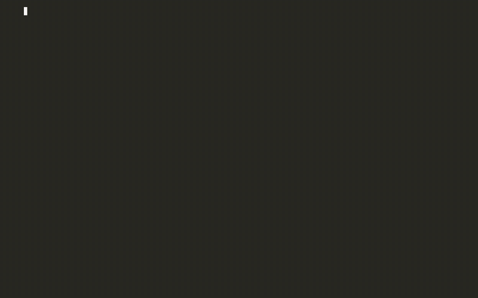
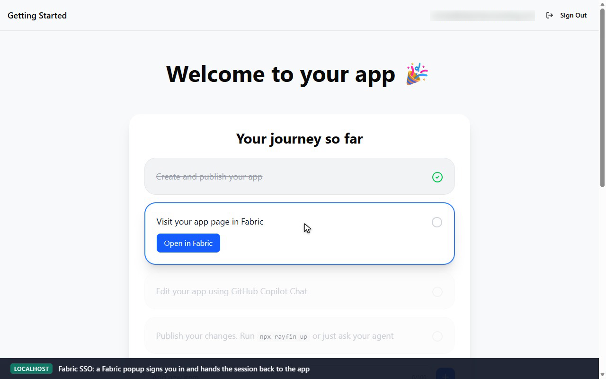
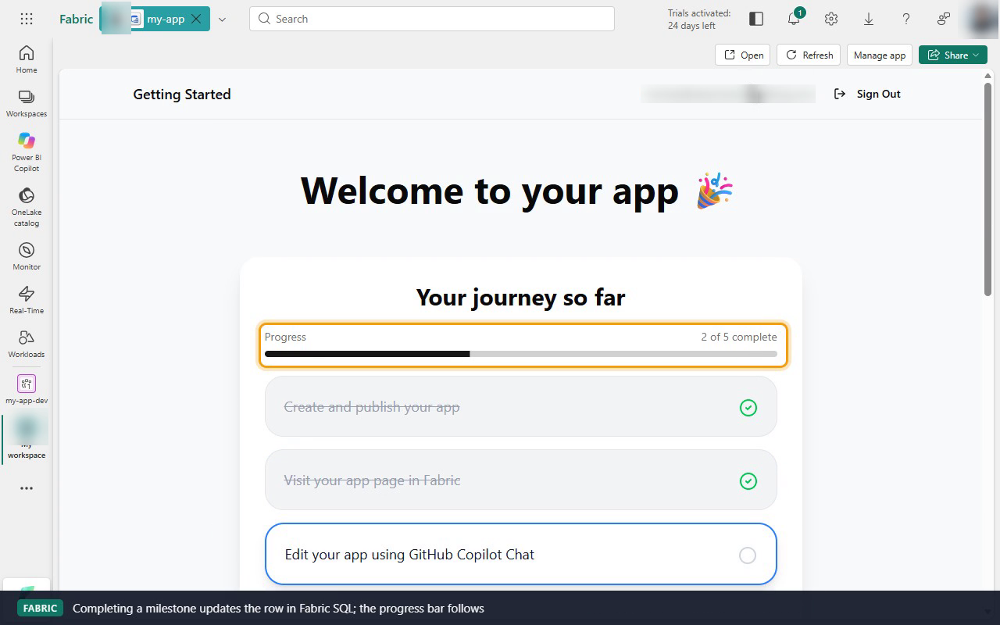
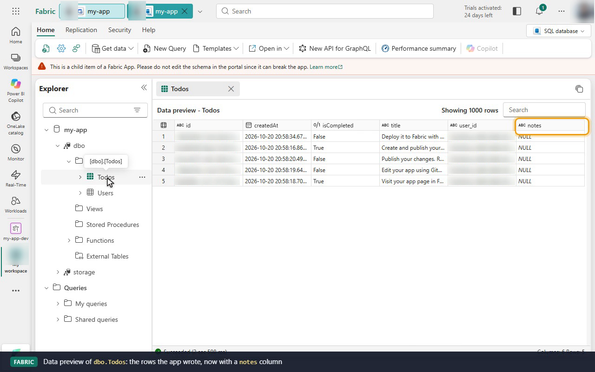

# Demo: Create and deploy your first Fabric app with the Rayfin CLI

Follows [Create and deploy your first Fabric app with the Rayfin CLI](https://learn.microsoft.com/en-us/fabric/apps/create-app-with-cli):
scaffold an app, run it locally, add features, deploy to Fabric, verify the
deployment, and push database-only and frontend-only updates. The recording
checks each step on the Fabric side as well. It shows the app item in the
portal, the deployed app running inside Fabric and at its live URL, and the
schema change in the app's Fabric SQL database.



| File | What it is |
|------|------------|
| [`my-app/`](my-app/) | The app as it stands at the end of the demo (all three features applied) |
| [`features/`](features/) | The "build more features" changes, as patches applied during the demo |
| [`recording/demo.mp4`](recording/demo.mp4) | Full demo (3m49s): the terminal run cut together with four browser segments in Fabric |
| [`recording/demo.gif`](recording/demo.gif) | Same, as a smaller GIF |
| [`recording/demo.cast`](recording/demo.cast) | Terminal portion only, as an asciicast (`asciinema play recording/demo.cast`) |
| [`recording/local-app.png`](recording/local-app.png) | Step 3: the local frontend, signed in with Fabric SSO |
| [`recording/fabric-app.png`](recording/fabric-app.png) | Step 4: the deployed app running inside the Fabric portal |
| [`recording/fabric-sql.png`](recording/fabric-sql.png) | Step 6: the app's rows in the Fabric SQL editor, with the new `notes` column |

The browser segments, in order:

| After | What the recording shows in Fabric |
|-------|------------------------------------|
| Step 3, `rayfin dev` | Sign-in on `localhost:5173` through the Fabric SSO popup, milestones read from the app's database, an item added. Then **My workspace** holds the new `my-app` app item, SQL database and SQL endpoint |
| Step 4, `rayfin up` | The `my-app` item opens the deployed app inside Fabric, already signed in. It has the new progress bar and the item added locally. Completing a milestone moves the bar. **Manage app** shows the live URL and publish time. The live URL on its own asks for a Fabric sign-in first |
| Step 6, `db apply` | **Manage app → Database** lists `notes nvarchar(500)` on `Todo`. The SQL editor's data preview of `dbo.Todos` shows the app's rows with the new column |
| Step 6, `staticapp deploy` | The app in Fabric shows the renamed header with the same data, and a new publish time |

## Prerequisites

- Node.js 20+ and npm
- A Fabric workspace where you're Contributor, Member, or Admin (the demo uses **My workspace**)
- The Fabric Apps workload enabled in the tenant
- A Fabric sign-in. The CLI opens a browser sign-in the first time it needs one; to sign in up front, run `npx rayfin login` inside the project.

## Step 1: Create a new project

```bash
npm create @microsoft/rayfin@latest -- my-app --workspace "My workspace" -t gettingstartedauth
cd my-app
npx rayfin init .
```

In a terminal, `npm create` asks you to pick a template. The demo passes
`-t gettingstartedauth` (*A Todo App with Auth and Getting Started Docs*). It
has the layout this tutorial describes: `rayfin/rayfin.yml`, a data model in
`rayfin/data/`, and the frontend at the project root. The default template
(`blankapp`) is a monorepo with data turned off, so Steps 2 and 6 wouldn't
apply to it.

`npx rayfin init .` is the alternative for an empty folder or existing source
code. In a project `npm create` just scaffolded, `rayfin.yml` already exists,
so it asks before overwriting and, with no answer, prints
`❌ Initialization cancelled` and leaves the project as is.

## Step 2: Review the generated project

| Path | Contents |
|------|----------|
| `rayfin/rayfin.yml` | Services: Fabric auth, `mssql` data, static hosting |
| `rayfin/.env` | CLI-managed values. Holds only `RAYFIN_WORKSPACE_NAME` until the first `dev`/`up` adds the item ID, API URL, and publishable key |
| `rayfin/data/Todo.ts` | `Todo` entity with a per-user row-level security policy |
| `src/` | React + Vite + Tailwind frontend |

## Step 3: Run the app locally

```bash
npx rayfin dev --workspace "My workspace"
```

On the first run, `rayfin dev` creates the `my-app` backend in Fabric (the
demo adds `--yes` to accept the create prompt). It then applies the data model
and starts Vite on `http://localhost:5173`.

Pass `--workspace` here even though `npm create` already saved it. In CLI
1.36.2, `rayfin dev` reads only `--workspace`, `--workspace-id`, or
`RAYFIN_WORKSPACE_ID`, not the `RAYFIN_WORKSPACE_NAME` that `npm create` wrote
to `rayfin/.env`. Without one, it creates a new workspace named
`my-app-<timestamp>` and assigns it a capacity. On this tenant it picked the
paid F4 capacity over the trial that **My workspace** runs on. `rayfin up`
does read `RAYFIN_WORKSPACE_NAME`, but after the first `dev` it follows the
deployment `dev` recorded instead.

Sign in with **Sign in with Microsoft**. A Fabric popup authenticates you and
hands the session back to the app, with no redirect page. The journey
milestones on the dashboard are rows in the app's Fabric SQL database.



## Step 4: Build features and deploy

[`features/01-journey-progress.patch`](features/01-journey-progress.patch) adds a progress bar to the journey card. Preview, then deploy:

```bash
patch -p1 < ../features/01-journey-progress.patch
npx rayfin up --dry-run
npx rayfin up
```

The deploy prints the hosted app URL (`https://<name>.webapp.fabricapps.net`) and the Fabric portal link.

In the portal, the `my-app` item (type **App**) has the SQL database and SQL
endpoint nested under it. Opening the item runs the deployed app inside Fabric,
signed in through Fabric SSO and backed by the same database as the local
session. **Manage app** shows the live URL, the last publish time, and the
Database, Functions, and Metrics pages.



Static hosting uses `assetAccess: protected`. Opened on its own, the live URL
shows Fabric's *Sign in to continue* page, and a `curl` gets
`401 {"error":"Authentication required."}`.

## Step 5: Verify the deployment

```bash
npx rayfin up status
npx rayfin up status --json
```

> **CLI quirk (1.36.2):** the *SQL Database* section of `up status` shows the
> first SQL database in the workspace, not necessarily this app's. Here
> `my-app` was the first app in **My workspace**, so its status is right. Run
> after the [author-templates](../author-templates/) demo, `up status` for
> `starter-app` and for `test-output` both report `my-app`'s database. Each app
> does get its own database, as the Fabric portal shows.

## Step 6: Deploy database or static content only

Data model only. [`features/02-todo-notes-column.patch`](features/02-todo-notes-column.patch) adds an optional `notes` column to `Todo`:

```bash
patch -p1 < ../features/02-todo-notes-column.patch
npx rayfin up db apply
```

Check it in **Manage app → Database**, or open the database in the Fabric SQL
editor. The entity `Todo` is stored as the table `dbo.Todos`, and its data
preview shows the rows the app wrote with the new `notes` column. The editor
warns that this is *a child item of a Fabric App*: change the schema through
`db apply`, not in the portal.



Frontend only. [`features/03-header-title.patch`](features/03-header-title.patch) renames the header:

```bash
patch -p1 < ../features/03-header-title.patch
npx rayfin up staticapp deploy
```

The app in Fabric now reads **My App** in the header. The data is unchanged,
and **Manage app** shows a new publish time.

A nullable column is additive, so `db apply` succeeds without `--force`.
Changing a column's type or dropping a column needs `--force`.

> **Windows quirk:** after a successful `up --dry-run`, `up db apply`, or
> `up staticapp deploy`, Node can print
> `Assertion failed: !(handle->flags & UV_HANDLE_CLOSING)` on exit and return a
> non-zero code. The work has already completed (`✅ Configuration applied
> successfully!`, `✅ Static content deployed`). The recording hides that
> line, so script against the success message, not the exit code.

## Clean up

The demo creates the `my-app` app item in **My workspace**, with its SQL
database and SQL endpoint. Delete the app item in the Fabric portal when you're
done; its SQL database and endpoint go with it.
