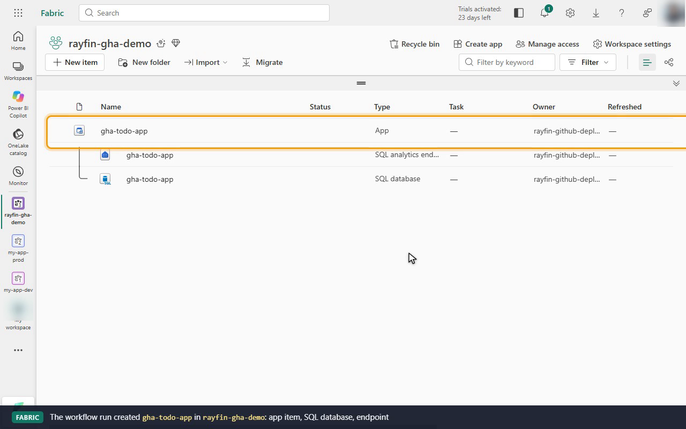
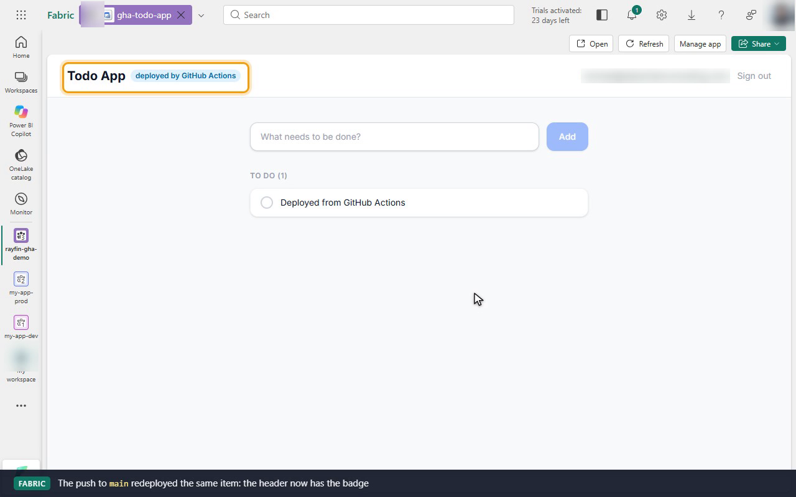

# Deploy a Fabric app with GitHub Actions

Demo of [Deploy Fabric apps with GitHub Actions](https://learn.microsoft.com/en-us/fabric/apps/deploy-github-actions):
a Rayfin "Basic Todo App" that deploys itself to a Fabric workspace on every push to `main`,
signing in with a service principal.

GitHub only runs workflows from `.github/workflows` at a repository root, so this folder is
published as its own repository. The recording used a private mirror,
`mjtpena/rayfin-deploy-github-actions`. To run it yourself, create an empty repository,
then edit the code here and run `scripts/publish.sh <owner/repo>` to push it there.


| File | What it is |
|------|------------|
| [`recording/demo.mp4`](recording/demo.mp4) | Full demo (3m11s): the terminal run cut together with three browser segments in Fabric |
| [`recording/demo.gif`](recording/demo.gif) | Same, as a smaller GIF |
| [`recording/demo.cast`](recording/demo.cast) | Terminal portion only, as an asciicast (`asciinema play recording/demo.cast`) |
| [`recording/fabric-access.png`](recording/fabric-access.png) | Steps 1–2: `rayfin-gha-demo` before the first run, with the service principal as Contributor |
| [`recording/fabric-first-deploy.png`](recording/fabric-first-deploy.png) | Step 4: the app item, SQL database and endpoint the manual run created, owned by the service principal |
| [`recording/fabric-push-deploy.png`](recording/fabric-push-deploy.png) | Step 4: the same app after the push-triggered run, with the new header badge |

The terminal shows the service principal and its workspace role, the repo secrets, and the
workflow. A `workflow_dispatch` run is watched to completion on a GitHub-hosted runner and its
deploy log printed. A push to `main` then triggers a second run. The browser segments, in order:

| After | What the recording shows in Fabric |
|-------|------------------------------------|
| Step 2 | `rayfin-gha-demo` is empty. **Manage access** lists `rayfin-github-deployer (Service Principal)` as Contributor |
| Manual run (`workflow_dispatch`) | `gha-todo-app` with its SQL database and endpoint, all owned by `rayfin-github-deployer`. Opened by a workspace member, the app runs inside Fabric through Fabric SSO, and a todo is added. **Manage app** shows the live URL and publish time from the run |
| Push to `main` | The same item now shows the **deployed by GitHub Actions** header badge from [`features/01-ci-badge.patch`](features/01-ci-badge.patch). The todo is still there and the publish time is new |

The account's private-repo Actions minutes were blocked by billing in October 2026, so the
repository was made public for the recorded runs (`39531412564` manual, `39531649602` push)
and set back to private straight after.

```text
deploy-github-actions/
├── .github/workflows/deploy-to-fabric.yml   # Step 3: the workflow
├── features/01-ci-badge.patch               # Step 4: the change pushed to main in the recording
├── scripts/
│   ├── setup-deployer.sh                    # Steps 1–2: service principal, workspace access, repo secrets
│   └── publish.sh                           # Mirror this folder to the GitHub repo (push to main)
├── rayfin/                                  # Rayfin config + data model (Todo entity)
└── src/                                     # React + Vite frontend (patch applied)
```

## Prerequisites

- A Fabric workspace on an active capacity (the demo uses `rayfin-gha-demo` on the trial capacity)
- The Fabric tenant setting **Service principals can call Fabric public APIs** turned on
- A GitHub repository you can add Actions secrets to, with Actions minutes available
- For the scripted setup: Azure CLI (`az login`) and GitHub CLI (`gh auth login`)

## Step 1: Create a service principal

Portal route: **Microsoft Entra ID > App registrations > New registration**. Record the
Application (client) ID and Directory (tenant) ID, create a client secret under
**Certificates & secrets**, and add the app as **Contributor** on the target workspace
(**Workspace > Manage access**).

Scripted route (also covers step 2):

```bash
az login
gh auth login
bash scripts/setup-deployer.sh <workspace-name> <owner/repo> [capacity-id]
```

The script creates (or reuses) the `rayfin-github-deployer` app registration, creates the
workspace if it doesn't exist, grants Contributor, and writes the four repository secrets.
The client secret goes straight from `az` into `gh secret set` and is never printed.

The tenant setting **Service principals can call Fabric public APIs** must be on. Check it in
**Admin portal > Tenant settings > Developer settings**.

## Step 2: Repository secrets

| Secret | Value |
| --- | --- |
| `CLIENT_ID` | Application (client) ID |
| `TENANT_ID` | Directory (tenant) ID |
| `CLIENT_SECRET` | Client secret value |
| `FABRIC_WORKSPACE_NAME` | Target workspace display name |

## Step 3: The workflow

See [.github/workflows/deploy-to-fabric.yml](.github/workflows/deploy-to-fabric.yml).

## Step 4: Trigger a deployment

```bash
# Automatic: any push to main
bash scripts/publish.sh <owner>/<repo> "Describe the change"

# Manual: Actions > Deploy to Fabric > Run workflow, or from the CLI
gh workflow run deploy-to-fabric.yml --repo <owner>/<repo>
gh workflow run deploy-to-fabric.yml --repo <owner>/<repo> -f force=true

gh run watch --repo <owner>/<repo>
```

`force=true` passes `--force` to `rayfin up` and allows destructive schema changes, such as
dropping a column. Leave it off for normal deploys.

The **Deploy to Fabric** step log ends with the Fabric portal link and the app URL.

In the portal, the first run creates `gha-todo-app` (type **App**) with its SQL database and SQL
endpoint. The **Owner** column shows `rayfin-github-deployer`, the service principal the
workflow signs in as. Workspace members still open the app through Fabric SSO.



A later push to `main` redeploys the same item. In the recording, the push applies
[`features/01-ci-badge.patch`](features/01-ci-badge.patch), and the app in Fabric then shows the
badge, keeps its data, and gets a new publish time.



Both recorded runs ended with two annotations that don't fail the job, but they will matter:
`actions/checkout@v4` and `actions/setup-node@v4` target Node.js 20 and are being forced onto
Node.js 24, and `ubuntu-latest` moves to Ubuntu 26 from October 19, 2026. Re-check the
`Install libsecret` step if a run lands on the new image and `libsecret-1-0` isn't found.

## Changes from the docs workflow

The YAML on the docs page doesn't deploy as written. Each change below was reproduced by
replaying the workflow steps from a fresh clone as the service principal, on Windows and in a
`node:20` Linux container, and the libsecret fix on a GitHub-hosted runner (Rayfin CLI 1.36.2,
Oct 2026):

| Change | Why |
| --- | --- |
| `\` after the `-t` and `-u` lines of `rayfin login` | The docs' block has no line continuations there, so `rayfin login` gets only `-t`, and the shell runs `-u $CLIENT_ID` as a separate command, which fails the step. |
| `-p "$CLIENT_SECRET"` instead of `-p CLIENT_SECRET` | The docs pass the literal text `CLIENT_SECRET` as the secret. |
| `npm ci` step added | `rayfin up` compiles `rayfin/data/*.ts` and runs `npm run build:fabric`, but it doesn't install packages. Without `node_modules` it fails with `TypeScript compilation failed` (`TS2688: Cannot find type definition file for 'vite/client'`). |
| `--encryption-fallback-enabled` on `rayfin login` | Linux without a keyring daemon fails with `OS keychain is not available and plaintext token storage is not enabled`. `rayfin up` inherits the setting from the saved login. |
| `Install libsecret` step (`apt-get install libsecret-1-0`) | On the hosted `ubuntu-24.04` runner (image 20261012), `rayfin login` crashes with `Error: libsecret-1.so.0: cannot open shared object file`, even with `--encryption-fallback-enabled`. The CLI loads `keytar` before it checks the fallback. The `node:20` container replay didn't catch this because that image ships libsecret. |
| `cache: npm` on `setup-node` | Faster `npm ci`. Optional. |

`rayfin/.env` and `rayfin/.deployments.json` are gitignored, so every run starts with no record
of earlier deployments. That's fine: `rayfin up` looks the item up by name (`gha-todo-app`) in
the workspace and reuses it. Two replays from different machines updated the same item.

## Clean up

- Delete the `gha-todo-app` app item from `rayfin-gha-demo` (its SQL database and SQL endpoint go with it), or delete the workspace.
- Remove the `rayfin-github-deployer` client secrets you no longer need: **Entra ID > App registrations > rayfin-github-deployer > Certificates & secrets**.
