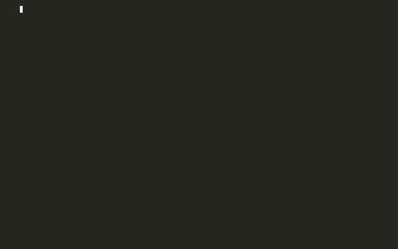
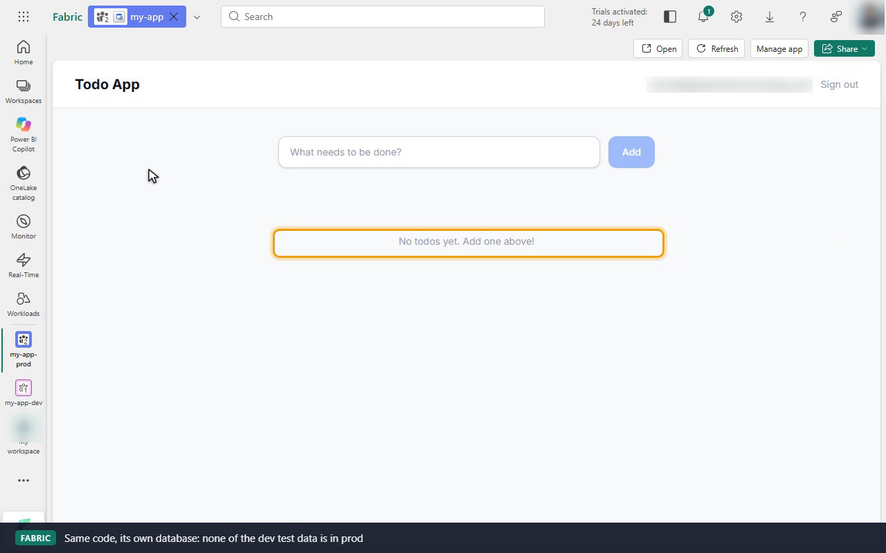
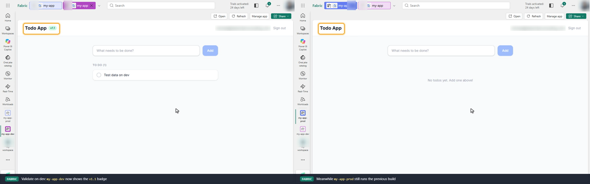
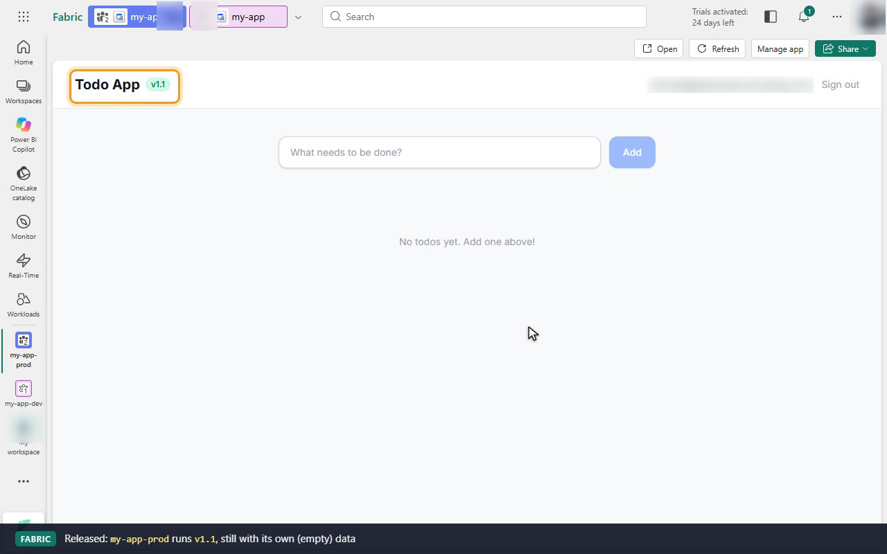

# Dev and prod workflow with the Rayfin CLI

Demo of [Set up a dev and prod workflow for Fabric apps](https://learn.microsoft.com/en-us/fabric/apps/dev-prod-workflow):
one Fabric app project, deployed to two workspaces (`my-app-dev`, `my-app-prod`), with
`rayfin up switch` to move between them. The recording checks each stage in Fabric too. It
shows the two app items with their separate databases, a schema change landing on dev first,
and a release that shows up on dev before prod.



| File | What it is |
|------|------------|
| [`recording/demo.mp4`](recording/demo.mp4) | Full demo (4m26s): steps 1–8, including step 8's fix-and-release loop, cut together with six browser segments in Fabric |
| [`recording/demo.gif`](recording/demo.gif) | Same, as a smaller GIF |
| [`recording/demo.cast`](recording/demo.cast) | Terminal portion only, as an asciicast (`asciinema play recording/demo.cast`) |
| [`recording/fabric-prod.png`](recording/fabric-prod.png) | Step 6: the prod app item. Same code as dev, with its own empty database |
| [`recording/fabric-dev-vs-prod.png`](recording/fabric-dev-vs-prod.png) | Step 8: dev running the `v1.1` fix (left) while prod still runs the previous build (right) |
| [`recording/fabric-release.png`](recording/fabric-release.png) | Step 8: prod running the `v1.1` release inside Fabric |

The browser segments, in order:

| After | What the recording shows in Fabric |
|-------|------------------------------------|
| Step 4, deploy to dev | `my-app-dev` holds the `my-app` app item, SQL database and endpoint. The item runs the app inside Fabric, and a todo is added as dev test data |
| Step 5, `npm run dev` | `localhost:5173` signs in through Fabric SSO and shows the same dev todo: local code, dev backend |
| Step 5, `db apply` | **Manage app → Database** on the dev item lists the new `dueDate` column |
| Step 6, promote to prod | `my-app-prod` has its own `my-app` item. The app is empty because prod has its own database. The schema includes `dueDate`, and the item has its own live URL |
| Step 8, fix on dev | The dev app shows the `v1.1` badge, while the prod app still runs the previous build |
| Step 8, release | The prod app shows `v1.1`, with a new publish time on the same item |

```text
dev-prod-workflow/
├── scripts/
│   └── create-workspaces.sh   # Step 1: creates my-app-dev and my-app-prod via the Fabric REST API
├── features/                  # Changes applied during the demo, as patches
│   ├── 01-due-date.patch      # Step 5: optional dueDate column (schema-only change)
│   └── 02-release-v1.1.patch  # Step 8: the fix released through dev, then prod
└── my-app/                    # Step 3: scaffolded from the "Basic Todo App" (todoapp) template, both patches applied
```

`my-app/rayfin/.env` and `my-app/rayfin/.deployments.json` hold the recorded deployments. They're
gitignored, so a fresh clone starts with no deployments recorded. Run step 4 onward to recreate them.

## Prerequisites

- Node.js 20+
- A Fabric tenant where you can create workspaces, and a Fabric capacity (a trial capacity works)
- Azure CLI (`az login`) if you use the workspace script or the token sign-in below

## Step 1: Create the dev and prod workspaces

Create `my-app-dev` and `my-app-prod` in the Fabric portal, or run the script (it reuses
workspaces that already exist):

```bash
bash scripts/create-workspaces.sh <capacity-id>
```

## Step 2: Sign in to Fabric

```bash
npx rayfin login                     # interactive; add --tenant <tenant id> to pick a tenant
npx rayfin login status
```

Can't open a browser (remote shell, agent session)? The CLI also accepts a Fabric token
through `RAYFIN_TOKEN`, so you can borrow your Azure CLI session instead:

```bash
export RAYFIN_TOKEN=$(az account get-access-token \
  --resource https://api.fabric.microsoft.com --query accessToken -o tsv)
```

The token lasts about an hour. Re-run the export when commands start returning 401.

## Step 3: Create the project

```bash
npm create @microsoft/rayfin@latest my-app -- --workspace my-app-dev --template todoapp
cd my-app
```

Without `--template` the scaffolder asks which template to use. The recording runs this
from an empty folder; [`my-app/`](my-app/) is what it produced, plus the two patches below.

## Step 4: Deploy to dev

```bash
npx rayfin up --dry-run --verbose    # preview: resolves the workspace, plans the operations
npx rayfin up --workspace my-app-dev
```

In the portal, `my-app-dev` now holds the `my-app` app item with its SQL database and SQL
endpoint. Opening the item runs the dev build inside Fabric.

## Step 5: Iterate against dev

```bash
npm run dev                          # local frontend at http://localhost:5173, backed by the dev item
patch -p1 < ../features/01-due-date.patch
npx rayfin up db apply               # schema-only change
npx rayfin up                        # full redeploy to the active (dev) workspace
```

The local frontend talks to the dev item, so it shows the dev test data after you sign in.
[`features/01-due-date.patch`](features/01-due-date.patch) adds an optional `dueDate`
column to [my-app/rayfin/data/Todo.ts](my-app/rayfin/data/Todo.ts). `db apply` changes only
the dev database: **Manage app → Database** on the dev item lists the new column.

## Step 6: Promote to prod

```bash
npx rayfin up --workspace my-app-prod
```

This creates a second Fabric app item in `my-app-prod` and makes prod the active deployment.
It's the same code with a separate database. The prod app opens empty, with none of the dev
test data. Its schema already has `dueDate`, because a full deploy applies the current data
model, and it has its own live URL.



## Step 7: Switch between deployments

```bash
npx rayfin up list                   # both deployments; * marks the active one
npx rayfin up switch --list
npx rayfin up switch my-app-dev      # back to feature work
npx rayfin up switch my-app-prod     # hotfix or validation
```

`switch` rewrites the `RAYFIN_PUBLIC_*` values in `rayfin/.env` and regenerates `.env.local`
for Vite, so `npm run dev` follows the active deployment too.

## Step 8: Validate prod

```bash
npx rayfin up status                 # item, SQL database, endpoint reachability
```

Open the hosting URL that `rayfin up` printed. Static hosting uses `assetAccess: protected`, so
the URL shows Fabric's sign-in page to a browser and returns 401 to anything without a Fabric
session. Or open the app item in the portal, which runs the app already signed in.

To ship a fix, release it through dev first:

```bash
npx rayfin up switch my-app-dev
patch -p1 < ../features/02-release-v1.1.patch
npm run rayfin:up -- --yes           # deploy to dev, then validate in Fabric
npx rayfin up switch my-app-prod
npm run rayfin:up -- --yes           # release the same project to prod
```

[`features/02-release-v1.1.patch`](features/02-release-v1.1.patch) adds a `v1.1` badge to
the header, so you can see which build each environment runs. It also adds the `rayfin:up`
script that the template README promises. In the recording, the dev app shows `v1.1` while
prod still runs the previous build, until the release. Both deployments keep their item IDs
across redeploys.





## Notes from running it (Rayfin CLI 1.36.2, Oct 2026)

- The docs' step 3 command, `npm create @microsoft/rayfin@latest my-app --workspace my-app-dev`,
  fails with `ENOENT ... package.json`, because npm takes `--workspace` as its own flag. Put `--`
  before the scaffolder's options, as shown above.
- `RAYFIN_WORKSPACE_NAME` in `rayfin/.env` keeps the value from scaffolding (`my-app-dev`)
  through every `up --workspace` and `switch`. Only the `RAYFIN_PUBLIC_*` values and the
  `active` entry in `rayfin/.deployments.json` move. That's harmless: `up list`, `up status`,
  and a plain `rayfin up` all follow the active deployment. Don't read the workspace name in
  `.env` as "where the next deploy goes".
- The template README lists `npm run rayfin:up`, but the template's `package.json` has no such
  script. The release patch adds it.
- With `RAYFIN_TOKEN` set, `up switch` still prints `⚠️ Not signed in ... Run rayfin login
  --tenant <id> before rayfin up`. Ignore it: the next `rayfin up` uses the token and deploys.
- On Windows, `up db apply` can exit non-zero after it succeeds (Node's
  `UV_HANDLE_CLOSING` assertion). Check for `✅ Configuration applied successfully!` instead
  of the exit code.

## Clean up

Delete the `my-app-dev` and `my-app-prod` workspaces in the Fabric portal. Each holds one `my-app` app item with its SQL database.
